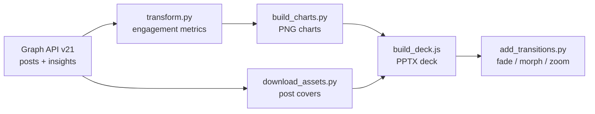

# Instagram Campaign Analytics

Turn any Instagram business/creator profile into a **client-ready analytics deck** — data collection via Meta's Graph API, campaign classification, competitor benchmarking, and an automated **PPTX presentation** with charts, real post covers, and slide transitions.

🇧🇷 _Versão em português: [README.pt.md](README.pt.md)._

## The problem

Agencies burn hours every month copying Instagram metrics into slides by hand. This pipeline does the whole loop in one command: fetch the data, compute engagement, classify posts by campaign, build the charts, and assemble a branded presentation — including things the usual tooling can't do, like slide transitions injected into the PPTX and private Insights (reach, shares, saves) per post.

## Pipeline



## What it does

- **Collects** posts, likes and comments from any business/creator account (Graph API v21)
- **Classifies posts by campaign** using configurable caption keywords
- **Fetches private Insights** per post — views, reach, shares, saves (for accounts you manage)
- **Benchmarks competitors** via `business_discovery`: followers, posting volume and average engagement of any business account, no account access needed
- **Builds a PPTX deck** (pptxgenjs) with charts, real post covers in their original aspect ratios (1:1, 4:5, 9:16) and auto-generated insights
- **Injects slide transitions** (fade, morph, push, zoom) into the finished PPTX — something pptxgenjs itself can't do
- **Exports PDF** from HTML decks via headless Chrome

## Quick start

```bash
# 1. Configure .env (copy from .env.example) with your Meta ACCESS_TOKEN
# 2. Full pipeline: collect -> analyze -> charts -> PPTX deck
./gerar_relatorio.sh <username> "Client Name"
```

### Campaign analysis

```bash
# define campaigns in data/gold/<username>_campanhas_config.json
# (template in examples/campanhas_config.example.json)
python3 scr/extract_insights_campanhas.py <username>
```

### Competitors

```bash
python3 scr/extract_concorrentes.py <your_ig_user_id> profile1 profile2 profile3
```

### PPTX transitions

```bash
python3 tools/add_transitions.py deck.pptx --zoom 1 --morph 9-12
```

Morph requires PowerPoint 2019+; it degrades gracefully to fade on older versions.

### HTML deck to PDF

```bash
python3 tools/html_deck_to_pdf.py deck.html output.pdf
```

## Requirements

1. An Instagram **Business or Creator** account linked to a Facebook Page
2. An app at [developers.facebook.com](https://developers.facebook.com) with a token carrying: `instagram_basic`, `business_management`, `pages_show_list`, `pages_read_engagement` (+ `instagram_manage_insights` for views/shares/saves)
3. `pip install -r requirements.txt` and `npm install -g pptxgenjs`
4. Graph API Explorer test tokens expire in 1-2h; generate a new one when collection fails with error 190

## Project layout

| File | Role |
|---|---|
| `scr/extract_search.py` | raw collection (posts, likes, comments) |
| `scr/transform.py` | engagement metrics (silver/gold CSVs) |
| `scr/extract_insights_campanhas.py` | private per-post insights, classified by campaign |
| `scr/extract_concorrentes.py` | competitor benchmarking (business_discovery) |
| `relatorio/build_charts.py` | PNG charts + report numbers |
| `relatorio/download_assets.py` | profile photo and post covers |
| `relatorio/build_deck.js` | PPTX presentation (set `BRAND` in the environment) |
| `tools/add_transitions.py` | slide transitions via PPTX XML |
| `tools/html_deck_to_pdf.py` | HTML deck → paginated PDF |

## API limitations

- Third-party accounts: public likes and comments only (no reach/impressions)
- Insights (views, shares, saves) require admin access to the account
- `business_discovery` cannot see personal accounts

## Credits

Adapted from [Analise_instagram](https://github.com/GabrielGalani/Analise_instagram), extended with campaign analysis, per-post insights, competitor benchmarking and deck generation.

## Author

Built by **Luis Azevedo** — available for freelance / consulting work on video, short-form content, and automation.
📬 [contato@midianoxx.com](mailto:contato@midianoxx.com)

## License

MIT
